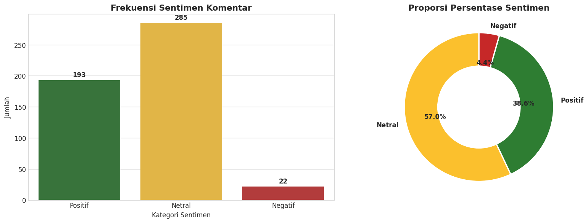

# End-to-End YouTube Comments Sentiment Analysis & Indonesian NLP Pipeline

## Project Overview

Proyek ini adalah pipeline **Natural Language Processing (NLP) & Analisis Sentimen Bahasa Indonesia** berbasis end-to-end yang mengambil data opini publik secara langsung (*real-time scraping*) dari **YouTube Data API v3**, menjalankan pembersihan teks mendalam (*Indonesian Slang Normalization*), serta menerapkan mesin klasifikasi sentimen berbasis aturan (*Negation-Aware Sentiment Engine*).

### Tujuan Utama:
1. **Automated Scraping:** Mengambil 500 komentar publik YouTube secara dinamis melalui integrasi resmi YouTube Data API v3 dengan mekanisme *pagination token*.
2. **Text Preprocessing & Slang Normalization:** Mengeliminasi derau (*noise* seperti mention, URL, hashtag, simbol asing) serta memetakan singkatan dan bahasa gaul lokal Indonesia (`yg` -> `yang`, `mantul` -> `mantap`, `ga/gak` -> `tidak`).
3. **Negation-Aware Sentiment Engine:** Mengatasi kelemahan algoritma sentimen konvensional dengan membalikkan polaritas kata saat didahului oleh penyangkal (contoh: *"tidak bagus"* secara akurat diklasifikasikan sebagai **Negatif**, bukan Positif).
4. **Visual Analytics & WordCloud:** Menyajikan visualisasi distribusi sentimen dan awan kata kunci emosional setelah penyaringan kata henti (*stopwords*).

---

## Coba Langsung di Google Colab

Notebook ini dapat dijalankan langsung di cloud tanpa instalasi lokal:

[Jalankan di Google Colab](https://colab.research.google.com/drive/1H2cyYVkeH3tRTUXjHypsI-PYQoJedkf3)



---

## Alur Arsitektur & Metodologi Pipeline

```
[YouTube Video Target (ID: TVvc8K8VwNI)]
                   │
                   ▼ (YouTube Data API v3 + Pagination)
[Raw Comment Corpus (500 Komentar)]
                   │
                   ▼
[Text Preprocessing & Slang Normalizer]
  ├── Regex URL & Mention Stripping
  └── Kamus Normalisasi Slang Indonesia (SLANG_MAP)
                   │
                   ▼
[Negation-Aware Lexicon Scoring Engine]
  ├── Token-Level Word Matching (Anti-Substr Bug)
  └── Multi-step Negation Detection ("tidak", "bukan", "kurang")
                   │
                   ▼
[Exploratory Data Analysis & Visualization]
  ├── Distribusi Polaritas (Seaborn Barplot)
  └── Ekstraksi Kata Kunci Dominan (WordCloud)
```

---

## Ringkasan Hasil Analisis Sentimen

Dari 500 komentar publik yang berhasil dianalisis:

| Kategori Sentimen | Jumlah Komentar | Persentase | Interpretasi Analitis |
| :---: | :---: | :---: | :--- |
| **Netral** | **285** | **57.0%** | Dominasi pertanyaan teknis, komentar deskriptif tanpa polaritas emosi tajam. |
| **Positif** | **193** | **38.6%** | Apresiasi terhadap kualitas konten, penyampaian materi edukatif, dan respon solutif. |
| **Negatif** | **22** | **4.4%** | Kritik minor terkait durasi penjelasan atau kendala teknis spesifik. |

---

## Struktur Repositori

```
├── README.md                          # Dokumentasi teknis & metodologi NLP
├── youtube_sentiment_pipeline.ipynb   # Jupyter Notebook pipeline lengkap
├── youtube_comments_raw_500.csv       # Dataset mentah 500 komentar
└── assets/
    └── nlp_results_preview.png        # Grafik visualisasi distribusi sentimen & WordCloud
```

---

## Author & Kontak

* **Nama:** Rifasa Hadiarto
* **Sertifikasi:** Certified Data Analyst — Badan Nasional Sertifikasi Profesi (BNSP)
* **Email:** rifasahadiarto5@gmail.com
* **LinkedIn:** [linkedin.com/in/rifasahadiarto](https://linkedin.com/in/rifasahadiarto)
